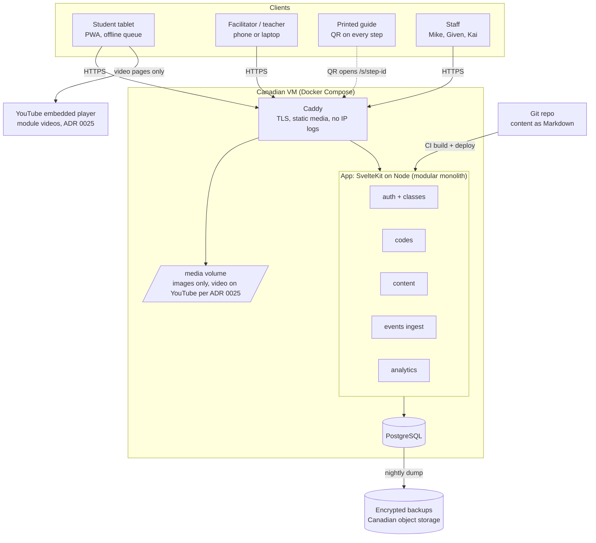

# JADE Learning Platform: Architecture v2

Date: 2026-11-14. Supersedes the "Pickney Learning Platform: Hosting & Data Architecture" doc of 2026-10-25 (v1). What changed and why is in `REVIEW.md`.

> Amended 2026-11-16 by [ADR 0025](../adr/0025-youtube-embedded-module-video.md): module videos play from YouTube in an embedded player (sections 2, 3, 4, 9, 10 and 14). The handoff text is in git commit 079e846 and jade-handoff.zip.

## 1. What this is

One web app that hosts the learning modules for JADE STEM kits. A code printed in each kit unlocks the material. Every step a group views, replays, gets stuck on or answers is logged against the kit's anonymous ID, so the team can see which steps to rewrite between pilots.

The first kit it serves is the DIY mechanical arm (ages 8 to 10, January classroom pilot, March Break camp pilot). The platform itself knows nothing about arms: a kit is a row in a table plus a folder of content.

## 2. Design principles

1. **Adults hold accounts, children never do.** No child names, emails or passwords anywhere in the system.
2. **The kit is the unit.** A group of two or three shares one tablet, so data is recorded per kit, not per child.
3. **Nothing is recorded without consent.** Logging is off per kit until a facilitator confirms consent. With it off, the content still works and the server stores no activity.
4. **Paper still works.** The printed guide is complete on its own. The platform adds video, checkpoints, help and data.
5. **One deployable, one database, one origin.** One developer has to build and run this. No microservices, no third-party scripts, one domain for a school to allowlist. The one exception is the embedded YouTube player on pages that show a module video, so a school must also allow YouTube ([ADR 0025](../adr/0025-youtube-embedded-module-video.md)).
6. **Every data point names the content version it came from.** Otherwise Pilot 1 and Pilot 2 cannot be compared.
7. **Boring and portable.** Docker Compose on a Canadian VM. Moving hosts is a restore, not a rewrite.

## 3. System overview



`architecture.png` is the same picture as an image.

## 4. Components

| Component | Responsibility | Notes |
|---|---|---|
| Caddy | TLS, HTTP/2, compression, serves `/media` with Range requests | Only public service. Access log off or IP-stripped. Video is no longer served from `/media`; what the `/media` gate becomes is open ([ADR 0025](../adr/0025-youtube-embedded-module-video.md)) |
| App (SvelteKit, adapter-node, TypeScript) | All pages and all API routes | Server-rendered; forms work without JavaScript where possible |
| `auth` module | Adult accounts and sessions, staff role, invites, student device sessions, authorization | |
| `codes` module | Generate, normalise, HMAC, redeem, revoke kit codes | |
| `content` module | Load Markdown content at build time, render, version lock, short links | |
| `events` module | Event catalog, ingest endpoint, consent gate, progress | |
| `analytics` module | SQL views, data-quality report, exports, staff dashboards | Reads the same database |
| PostgreSQL 16 | Everything persistent | Single instance, nightly encrypted backups |
| Media volume | Images. Module videos are on YouTube, unlisted and marked made for kids, not on this volume ([ADR 0025](../adr/0025-youtube-embedded-module-video.md)) | Served same-origin; whether through the signed-URL gate is open ([ADR 0025](../adr/0025-youtube-embedded-module-video.md)) |
| Git repo | Code and content | Content changes go through the same CI |

Repo layout the build should follow:

```
src/lib/server/{auth,codes,content,events,analytics}/   one folder per module, index.ts is its public API
src/lib/shared/events/                                  event catalog (zod), used by client and server
src/routes/(student)/  (adult)/  (staff)/  api/
content/<kit>/<module>/<step>.md
migrations/
tools/                                                  code generator, video prepare, QR export
docs/adr/  docs/runbook/  docs/handoff/
```

Modules call each other only through their `index.ts`. That is the whole "architecture enforcement" for a monolith this size.

## 5. Users and access

| Actor | How they get in | Can do |
|---|---|---|
| Student device | Class join code, then tap the kit number. Receives a device-session cookie bound to class + kit | Read entitled content, send events for its own kit |
| Adult (facilitator, teacher, parent) | Email + password. Signup needs a valid kit code or a staff invite | Own classes, redeem kits, run sessions, toggle logging, record notes and quiz results |
| Staff | Adult account with staff role | Everything, plus codes admin, analytics, exports, deletion |

There is no open registration and no email service in v1. For the two pilots the adults are the team's own facilitators and one teacher, so staff-assisted password reset is enough. Email-based reset arrives with retail (extension point E4).

### Classroom flow

1. Facilitator signs in, creates a class, redeems the kit codes into it (scan each card's QR).
2. For each kit, facilitator confirms consent and switches logging on. Kits without full consent stay off.
3. Facilitator opens a session. A 6-character join code appears.
4. Each group opens the site, types the join code, taps "Kit 07".
5. The device is now bound to that kit. Next session it resumes where the group left off. If the school's devices wipe cookies, re-joining is the same two steps.
6. Facilitator closes the session. The join code stops working.

## 6. Kit codes

Format `ARM-7KQ4-XM2H-9`: a 3-letter product prefix (placeholder `ARM` until the kit is named), 8 random Crockford Base32 characters, 1 check character. Crockford drops I, L, O and U, so codes survive being read aloud by a child.

- 8 Base32 characters are 40 bits, about 1.1 trillion combinations. That defeats online guessing behind a rate limit. It does **not** defeat offline brute force of a leaked table of plain hashes, which is why the database stores `HMAC-SHA256(pepper, code)` with a server-side secret, not `SHA-256(code)`.
- The plain code exists in two places only: the printed card and the packing CSV kept offline.
- A code maps to a `kit_id`. The kit keeps that ID for life, across pilots and classes, so a reused kit has one history.
- Redemption is single-use, transactional and audited. Staff can revoke and reissue.
- Losing the pepper invalidates every printed code. Its backup procedure is a launch task (`p10-secrets`).

## 7. Content model

```
Kit  →  Module  →  Step  →  blocks (text, image, video, checkpoint)
```

- Content is Markdown with YAML frontmatter in the repo. No CMS in v1.
- A step ID such as `arm.m3.s04` is permanent. It is never renamed and never reused.
- Each step has a `version`. `content.lock.json` records a hash per `id@version`. CI fails if a step's text changed without a version bump, so version labels in the data can be trusted.
- Each step declares `expected_seconds`. Analytics compares measured active time against it.
- A step may have beginner and advanced variants (`track`).
- `/s/<step_id>` is a stable short link. The QR printed beside a step never changes when the step is revised.
- The printed guide is exported from the same source, so print and web cannot drift.
- On deploy, step metadata is synced into a `content_steps` table so analytics can join without reading the repo.

Given authors in the GitHub web editor following `docs/content-authoring.md`; staging shows a preview. A visual CMS can be added later without changing the format (extension point E3).

## 8. Data collection

Full catalog in `EVENTS.md`, tables in `DATA-MODEL.md`.

### What is recorded (per kit, only with logging on)

| Signal | Redesign question |
|---|---|
| Step viewed, step completed, how the group arrived (navigation, resume, printed QR) | Where do groups stall or drop off? Which printed steps send kids to the screen? |
| Active time per step (visible and recently interacted, idle cut off at 60 s) | Which steps run far over their expected time? |
| Video play, pause, seek, watched ranges | Which seconds get replayed or skipped? |
| "I'm stuck" with a preset reason, and how it resolved | What kind of trouble each step causes, and how long it takes to clear |
| Checkpoint answer (option, correct, attempt number) | Which misconceptions survive the step? |
| Track switch | Is beginner too easy or advanced too hard? |
| Facilitator note (step, issue type, severity, short note) | Adult observations on the same step IDs |
| Pre/post quiz and exit card, entered by an adult, keyed by kit + participant letter | Learning gain and enjoyment |

### Event integrity

- The client assigns each event a UUIDv7 and a `client_ts`. The server adds `received_at`. Events queued offline keep their real time.
- Ingest is idempotent: `INSERT ... ON CONFLICT (event_id) DO NOTHING`. A retried batch cannot double-count.
- Class and kit come from the device session, never from the payload. A device cannot write events for another kit.
- Events are validated against a versioned catalog shared by client and server. Unknown types and extra fields are rejected.
- Each event carries `step_id`, `content_version`, `track` and `app_version`.
- The events table is append-only for the app's database role.

### The consent gate

`class_kits.logging_enabled` is the single switch. When it is off:

- the ingest endpoint returns 204 and writes nothing,
- progress is kept on the device only,
- live stuck alerts still reach the facilitator but are held in memory, never stored,
- the client stops queueing events.

A required CI test (`p6-nolog-invariant`) runs a full student session with logging off and asserts that no activity row was written. That test is the evidence behind the opt-out sentence in the consent form.

## 9. Security and privacy

Abuse cases the build must cover (each gets a test in Phase 9):

| Abuse case | Mitigation |
|---|---|
| Guessing kit codes online | Rate limit per account, lockout, check character rejects most typos before the server |
| Brute-forcing a leaked code table | HMAC with server-side pepper |
| Guessing a join code | Valid only while a session is open, rate limited per device, rotated on demand |
| A group joins as another group's kit | Facilitator sees duplicate joins and can reset a kit's devices |
| Spoofing events for another kit | Kit identity comes from the session, not the payload |
| Sharing a video URL | Allowed by design: videos are unlisted on YouTube and anyone with the link may watch ([ADR 0025](../adr/0025-youtube-embedded-module-video.md); `docs/threat-model.md` AB6) |
| Student reaching adult or staff pages | Route-group authorization matrix, 404 not 403 |
| Free text capturing a child's name | Students have no free-text fields; adult note field carries a reminder |
| IP addresses as hidden identifiers | Not logged by Caddy or the app; used in memory for rate limiting only |

Other commitments: strict CSP with no third-party origins except the YouTube embed origin in `frame-src`, on pages that show a module video ([ADR 0025](../adr/0025-youtube-embedded-module-video.md)), no analytics or font CDNs, database and backups in Canada, deletion of all activity for a kit in one staff action, retention job that reduces raw events to aggregates after the agreed period. Details in `PRIVACY.md`. This is a privacy design, not legal advice; the consent form and research application need a human review against it (`p0-consent`).

## 10. Deployment

```
            Internet
               │ 80/443
        ┌──────▼──────┐
        │    Caddy    │── /media ── media volume
        └──────┬──────┘
               │ internal network
        ┌──────▼──────┐      ┌────────────┐
        │  app (Node) │──────│ PostgreSQL │── db volume
        └─────────────┘      └─────┬──────┘
                                   │ nightly pg_dump, encrypted
                             Canadian object storage
```

- **Environments:** local (Compose), staging (live from Phase 1, deployed on every merge to main), production (promoted by tag; same image that passed staging).
- **Releases:** build image, run forward-only migrations, start, health-check, switch. Rollback is the previous image. Migrations stay compatible with the previous app version.
- **Backups:** nightly encrypted dump, 30-day retention, restore drill before launch.
- **Monitoring:** external uptime check on `/readyz`, resource and 5xx alerts to a Discord webhook. Nothing runs in the user's browser.
- **Sizing:** decided by the Phase 9 load test at twice pilot size (30 devices). Video streams from YouTube, not from our VM, so video bandwidth no longer sizes the VM ([ADR 0025](../adr/0025-youtube-embedded-module-video.md)); the school's own connection still carries it.
- **Offline fallback:** printed guides plus the videos on a USB stick or facilitator laptop. In the runbook. With video on YouTube, this fallback and what a step shows when a video cannot load are open ([ADR 0025](../adr/0025-youtube-embedded-module-video.md)).

## 11. Analytics

Staff-only pages over SQL views:

1. **Data-quality report** per session: events per kit, gaps, flagged clocks, kits with logging off. Run the same day so a dead tablet is caught before the next session. Needed before Pilot 1.
2. **Export** to CSV/JSON. Needed before Pilot 1.
3. **Step heatmap** ranked by friction. Needed by February.
4. **Step detail:** funnel, time distribution, stuck reasons and time-to-unstuck, replay histogram, checkpoint spread, notes.
5. **Learning outcomes:** pre/post gain per question.
6. **Version compare:** v1 against v2 for the same step ID. Needed by March.

A pilot has 12 to 15 kits. Every rate is shown with its counts ("4 of 13 kits"), and friction is used to rank steps for attention, never reported as a result.

The loop: pilot runs → Given opens the heatmap → picks the top steps → diagnoses each (wording, video, diagram, hardware, sequence) → edits the step, version bumps → next pilot runs on the new version → version compare shows whether the fix worked.

## 12. Extension points (not in v1)

| ID | What | When it would matter | Where it plugs in |
|---|---|---|---|
| E1 | Device telemetry ingest | If a kit has networked electronics | New `source: device` events through the same ingest path, authenticated by a per-kit device key |
| E2 | AI question assistant | If the team brings it back | New server module behind the app; preset questions only; key stays server-side |
| E3 | Visual CMS for authors | If GitHub editing proves too awkward for Given | Git-backed CMS writing the same Markdown files |
| E4 | Email (magic links, self-serve reset) | Retail | `auth` module; needs a Canadian-region mail provider decision |
| E5 | Home mode | Retail | Parent account with one kit; bead `p3-home-mode` |
| E6 | A/B step variants | When there are enough kits for it to mean anything | `variant` column already reserved on events |
| E7 | Managed database or CDN | If usage outgrows one VM | Compose services are swappable; app reads `DATABASE_URL` |

## 13. Non-goals for v1

- Accounts, names or profiles for children
- Scores, leaderboards, badges
- Free-text input from students
- Self-serve public signup
- Multi-tenant organisations, payments, a storefront
- Real-time collaboration between tablets
- Native mobile apps

## 14. Risks

| Risk | Likelihood | Mitigation |
|---|---|---|
| School network blocks the domain, blocks YouTube or throttles video | Medium | Ask IT in week one (`p0-school-it`), one origin plus YouTube for video pages (for the pilot school, Given's responsibility, [ADR 0025](../adr/0025-youtube-embedded-module-video.md)), test on site, USB fallback (open, [ADR 0025](../adr/0025-youtube-embedded-module-video.md)) |
| School devices wipe cookies between sessions | Medium | Re-join is two steps; progress is server-side when logging is on |
| Five weeks to a mid-December freeze | High | Staging from week one; dashboards deferred to January; scope cuts listed in `REVIEW.md` |
| Consent or research approval does not cover the platform after the pivot | Medium | `p0-consent` starts on day one; no-log mode lets the pilot run regardless |
| Real content arrives late | Medium | Demo kit content unblocks the whole build; content release is its own bead |
| Single VM failure during a session | Low | Monitoring, tested restore, printed fallback |
| Pepper lost or leaked | Low | Offline backup in two places, rotation procedure |
