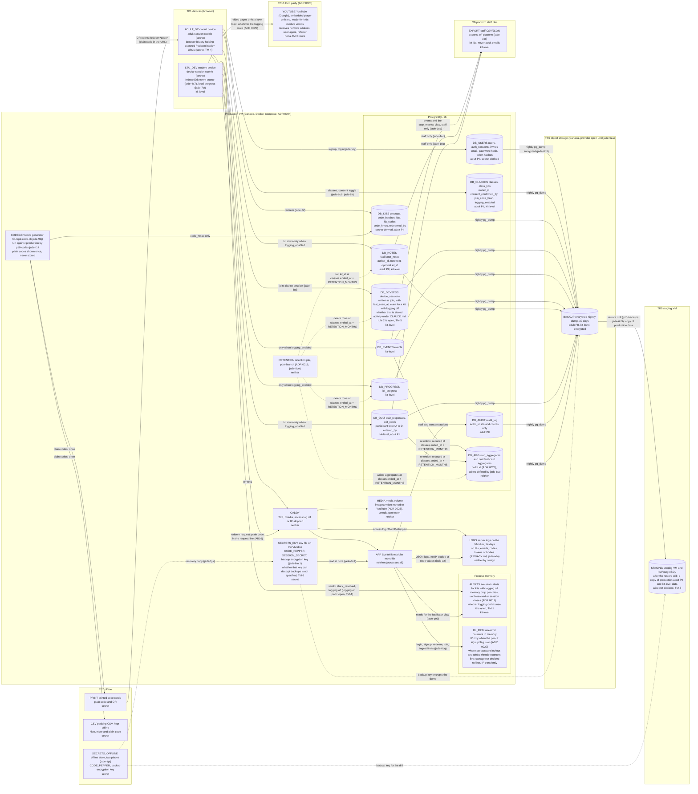

# Threat model and data flow

Status: 2026-11-14. Scope: v1 as designed in the handoff docs (`docs/handoff/`) and the accepted decisions ADR 0001 to ADR 0023 (`docs/adr/`), not as built. p9-authz-sweep (jade-sio) walks every abuse case in section 5 and links each to a passing test or a signed-off manual check (jade-sio acceptance). Every statement below cites a handoff doc section, an ADR or a bead; where the sources are silent it says "not decided" or "open" and points at section 7. Plan keys and their bead ids are from `docs/handoff/beads/id-map.json`; beads created after seeding (jade-lnn.1, jade-7s7.1, jade-7s7.2) and every bead's description and acceptance are from Beads (`bd show <id>`).

Amended 2026-11-16 for [ADR 0025](adr/0025-youtube-embedded-module-video.md) (module videos play from YouTube in an embedded player; it supersedes ADR 0007 and amends ADR 0013): the YouTube party in section 1, the Media row in section 2, TB10, the YOUTUBE node in section 4, AB6 and AB17 in section 5, and TM-9 and TM-10 in section 7. The mitigations ADR 0007 gave for video are kept in AB6 as history.

## 1. Actors

| Actor | How it gets in | What it can reach | What it must not reach |
|---|---|---|---|
| Student device | A group of 2 or 3 children shares one school device (ARCHITECTURE.md section 2, principle 2; assumption A2 of `docs/adr/README.md`). Types the class join code, taps its kit number, and receives a device-session cookie bound to class and kit (ARCHITECTURE.md section 5; ADR 0005; p3-join jade-5nj) | Content its kit is entitled to; events for its own kit only, and, for a kit with logging off, live stuck alerts for its own kit (ADR 0017; the alert path for kits with logging on is open, TM-1) (ARCHITECTURE.md section 5; p3-join jade-5nj "A device session can only read and write for its own kit") | Adult and staff pages (404, p3-authz-tests jade-aq5); another kit's data (jade-5nj, jade-aq5); any account, name or free-text field (CLAUDE.md rule 1) |
| Facilitator | An adult (facilitator, teacher or parent) with email and password; signup needs a valid unused kit code or a staff invite (ARCHITECTURE.md section 5; ADR 0005; p3-adult-auth jade-vcy) | Own classes: redeem kits, run sessions, toggle logging, record notes and quiz results (ARCHITECTURE.md section 5; p3-classes jade-bu6) | Other owners' classes (404, jade-bu6, jade-aq5); staff pages (jade-aq5); raw events (PRIVACY.md "Data inventory": the class owner sees progress and stuck state, not raw events) |
| Staff | An adult account with the staff role (ARCHITECTURE.md section 5); the team is Mike, Given and Kai (ARCHITECTURE.md section 3) | Everything, plus codes admin, analytics, exports and deletion (ARCHITECTURE.md section 5). Staff with server access can read server logs, and whoever holds the backup key can read backups (PRIVACY.md "Data inventory"), so staff are also the insider path to the VM, the env file and the backups (sections 3 and 5, AB14a, AB14b) | Plain kit codes, join codes, tokens and IP addresses from the database or logs, where they are never stored or logged (CLAUDE.md rule 4). Plain kit codes are held by staff off-platform, on the printed cards and in the packing CSV (p2-code-cli jade-99j; p10-codes jade-t17) |
| Outsider on school Wi-Fi | Same network and same public IP as the class (REVIEW.md finding 20; p9-ratelimit jade-6cq description); can see the join code shown in class (ARCHITECTURE.md section 5, "Classroom flow" step 3); the school's web filter or proxy is in the path, and whether it intercepts TLS is open until jade-tw4 (section 7) | What any browser can reach through Caddy on 80/443 (TB1); a join attempt while a session is open (AB3, AB4) | Anything behind a device session or adult session it does not hold (TB3, jade-aq5) |
| Outsider on the internet | Reaches Caddy on ports 80 and 443 only; app and database are not exposed on the host (ARCHITECTURE.md section 10; p1-docker jade-80h) | Public pages, the redeem, signup, login and join forms, and the media URLs it can obtain (AB1, AB3, AB6) | Everything behind authentication (TB3) |

Three non-human parties are named but not modelled in depth:

- The hosting and object-storage provider: who it is, its region and how it handles disks are open until p0-host (jade-0za) closes (ADR 0004; section 7).
- YouTube (Google): on pages that show a module video, the embedded player connects the student device to YouTube, which receives the device's network address, user agent and, as far as the referrer policy sends one, the referrer (ADR 0025; TB10). Its handling of that data is set by YouTube's and Google's own terms, not by any JADE source.
- The repository and CI path: GitHub is assumed (assumption A6 of `docs/adr/README.md`); code and content arrive through it, and content changes go through the same CI (ARCHITECTURE.md section 4; ADR 0006; p1-ci jade-xu0).

## 2. Assets

| Asset | Where it lives | Why it matters | Rule or ADR |
|---|---|---|---|
| Kit codes | Plain on the printed card, in large type and in a QR that opens `/redeem?code=...` (p2-code-cli jade-99j), and in the offline packing CSV (ARCHITECTURE.md section 6; jade-99j). Once the QR is scanned, the plain code is also in the redeem URL, so in the adult device's browser history and in the request line that Caddy and the app receive (TM-4, AB16). In the database only as `kit_codes.code_hmac` (DATA-MODEL.md section 1) | A code unlocks a kit's content and attaches the kit to a class (ARCHITECTURE.md section 6; p2-redeem jade-7if); 40 bits of entropy is brute-forceable from a leaked table of plain hashes (p2-code-lib jade-fd5) | ADR 0011; CLAUDE.md rule 4 (plain codes are never stored or logged) |
| Code pepper `CODE_PEPPER` | The app's env file on the VM (jade-lnn.1: "writes them only to the app's env file") and the team's offline store, in two places (p10-secrets jade-fgs); read through typed config with no production default (p1-config jade-8v4). Never in the database (ARCHITECTURE.md section 6) | A database dump alone does not allow offline guessing of codes (ARCHITECTURE.md section 6); losing the pepper invalidates every printed code, and leaking it weakens them (ARCHITECTURE.md section 6; jade-fgs) | ADR 0011 |
| Other secrets | `SESSION_SECRET` and the backup encryption key are generated on the VM and written to the app's env file (jade-lnn.1); the backup key is also in the team's offline store (jade-fgs). So the VM disk holds the database, `CODE_PEPPER` and the backup key together (TM-8) | `SESSION_SECRET` protects sessions (jade-8v4); the backup key protects the 30 days of backups (ARCHITECTURE.md section 10; p10-backups jade-6o3) | ADR 0004; ADR 0021 (the secrets work is split between jade-lnn.1 and jade-fgs) |
| Adult credentials and adult PII | `users` (email, optional display name, argon2id password hash), `auth_sessions.token_hash`, `invites.token_hash` (DATA-MODEL.md section 2); staff-issued one-time reset links (p3-adult-auth jade-vcy; where a reset link is stored is not decided); the adult session cookie, httpOnly, Secure, SameSite=Lax (jade-vcy). Adult ids also sit in `audit_log.actor_id`, `classes.owner_id`, `class_kits.consent_confirmed_by`, `kit_codes.redeemed_by`, `code_batches.created_by`, `facilitator_notes.author_id` (with the `note` text) and `entered_by` on `quiz_responses` and `exit_cards` (DATA-MODEL.md sections 1 to 3 and 5) | Adult email is the only personal information in the system (DATA-MODEL.md section 2) | ADR 0005; PRIVACY.md "Who the data is about" |
| Join codes | Shown in class while a session is open; stored as `classes.join_code_hash` while open (DATA-MODEL.md section 3; p3-join jade-5nj) | A join code binds a device to a kit (ARCHITECTURE.md section 5) | ADR 0005; CLAUDE.md rule 4 |
| Device-session tokens | Cookie on the student device; `device_sessions.token_hash` (DATA-MODEL.md section 3; jade-5nj) | Class and kit identity come from the device session (ADR 0008; CLAUDE.md rule 3) | ADR 0008 |
| Kit-level data, including event data | `events`, `kit_progress`, `facilitator_notes`, `quiz_responses`, `exit_cards`, `class_kits` (DATA-MODEL.md sections 3 to 5); `device_sessions`, written at join, with `last_seen_at`, even for a kit with logging off (DATA-MODEL.md section 3; whether that is stored activity under CLAUDE.md rule 2 is open, TM-5); live stuck alerts for kits with logging off, in app memory per class (ADR 0017; whether kits with logging on use the same store is open, TM-1); the student device's IndexedDB event queue (p6-client jade-4a7) and local progress (p5-progress jade-7cf); retention aggregates with no kit id (ADR 0023); staff exports (p8-export jade-1cc) | The data the team collects, with consent, to redesign modules (ARCHITECTURE.md section 1); kit ids are persistent identifiers (PRIVACY.md "Laws the team should check") | ADR 0009; ADR 0010; ADR 0017; ADR 0023; CLAUDE.md rule 2 |
| Backups | Nightly encrypted `pg_dump` to Canadian object storage, 30-day retention (ARCHITECTURE.md section 10; jade-6o3). Restored in full onto the staging VM for the restore drill (jade-6o3: "Perform a full restore onto staging"), so after the drill staging holds a copy of production adult PII and kit-level data, decrypted with the production backup key; when that copy is wiped is not decided (TM-3) | Everything in the database, for 30 days, including data already deleted from production (TM-7) | ADR 0004; ADR 0014 |
| Media | Images on a volume served by Caddy (ARCHITECTURE.md section 4); what the `/media` gate becomes now that video is not self-hosted is open (ADR 0025; p4-video jade-u8z). Module videos are unlisted on YouTube, marked made for kids, and playable by anyone with the link (ADR 0025); until ADR 0025 they were MP4 on the same volume behind signed, short-lived URLs (ADR 0007) | No personal data; video is not entitled per kit (ADR 0025) | ADR 0025 (supersedes ADR 0007) |

## 3. Trust boundaries

- **TB1 Browser to Caddy.** Over the internet or school Wi-Fi, with TLS; only 80 and 443 are published (ARCHITECTURE.md section 10; p1-docker jade-80h). Whether a school filter intercepts TLS is open until jade-tw4 (section 7).
- **TB2 Caddy to app.** The internal Compose network (ARCHITECTURE.md section 10); the Caddy access log is off or IP-stripped (ARCHITECTURE.md section 4; jade-80h).
- **TB3 Route groups inside the app.** `(student)`, `(adult)`, `(staff)` and `api/` (ARCHITECTURE.md section 4); the authorization matrix returns 404, not 403, and every route is in it (p3-authz-tests jade-aq5).
- **TB4 App to PostgreSQL.** The app's database role has insert and select on `events`, no update, and delete only through `delete_kit_data` (DATA-MODEL.md section 4).
- **TB5 VM to object storage.** The dump is encrypted client-side before upload (jade-6o3). The backup encryption key is generated on the VM and written to the app's env file (jade-lnn.1), with copies in the team's offline store (jade-fgs); whether the copy on the VM can decrypt backups or only encrypt them is not specified (TM-8). The provider is open until jade-0za.
- **TB6 CI and repository to the VM.** The image is built in CI and production receives the image that passed staging (ADR 0014; p1-staging jade-4zw; p10-cd jade-kn0).
- **TB7 Physical and offline.** Printed code cards, the packing CSV (jade-99j; p10-codes jade-t17: "store the CSV offline"), and the offline store of the pepper and the backup key (jade-fgs).
- **TB8 The shared student device.** Its cookie and IndexedDB queue are readable by the next user of the device (ARCHITECTURE.md section 2, principle 2; jade-4a7); school-managed devices may wipe cookies, which is open until jade-tw4 (ARCHITECTURE.md section 5, "Classroom flow" step 5).
- **TB9 Object storage to the staging VM.** Staging "uses its own secrets" (p1-staging jade-4zw; ADR 0014), but the p10-backups restore drill brings a decrypted copy of production data onto it and needs the production backup key there (jade-6o3); whether and when that copy is wiped is not decided (TM-3).
- **TB10 Student device to YouTube.** On pages that show a module video, the embedded player connects the device directly to YouTube (Google), outside the VM and whatever the kit's `logging_enabled` state (ADR 0025). The CSP `frame-src` allows the embed origin only (ADR 0025; p9-headers jade-c42). Which further origins the player loads inside its frame is open (TM-10).

## 4. Data-flow diagram

Every store of adult PII and kit-level data, and every secret that protects them. Each node says what it holds and whether that is adult PII, kit-level data, a secret, or neither. All browser traffic crosses TB1 to Caddy and then the app, except the YouTube player's on pages that show a module video (TB10, ADR 0025); the edges from the devices to the stores show where data ends up, not a direct connection. Rows in `events`, `kit_progress`, `facilitator_notes`, `quiz_responses` and `exit_cards` are written for a kit only when that kit's `logging_enabled` is true (ADR 0009; EVENTS.md server rule 2; DATA-MODEL.md sections 4 and 5). A `device_sessions` row is written at join whatever the logging state (DATA-MODEL.md section 3; p3-join jade-5nj); whether that counts as stored activity is open (TM-5).

Notes on the diagram:

- The media volume is "synced separately" from the database backup (jade-6o3); where it is synced to is not specified. It holds no personal data (ADR 0007).
- Exports leave the platform; where staff keep them and when they are deleted is not decided by any source. jade-1cc exports events, notes, quiz results and step metrics; step metrics come from the `step_metrics` view (ARCHITECTURE.md section 11; DATA-MODEL.md section 7). Whether exports read the retention aggregates is not decided.
- Which copy of the backup key the restore drill uses on staging is not specified; jade-6o3 says only that a full restore is performed onto staging (TM-3).

## 5. Abuse cases

AB1 to AB9 are the rows of ARCHITECTURE.md section 9, first column verbatim. AB10 to AB17 are beyond ARCHITECTURE.md section 9. Each mitigation names the bead that implements it, and that bead appears with its phase in the next column.

| ID | Abuse case | Mitigation (named) | Phase, plan key, bead | Verified by |
|---|---|---|---|---|
| AB1 | Guessing kit codes online | Check character rejects most typos before the server (jade-fd5); failed redemptions limited per account, 10 an hour then locked (jade-7if); a global failed-code throttle on redeem and code-gated signup (jade-7if, jade-vcy, jade-6cq); per-IP signup limit behind a flag, off by default (jade-vcy, jade-6cq) (ADR 0020) | Phase 2 p2-code-lib jade-fd5, p2-redeem jade-7if; Phase 3 p3-adult-auth jade-vcy; Phase 9 p9-ratelimit jade-6cq | jade-fd5 typo property test; jade-7if lockout test; jade-6cq flag off/on and global-throttle tests; jade-sio |
| AB2 | Brute-forcing a leaked code table | HMAC-SHA256 under the server-side pepper (jade-fd5, jade-o07; ADR 0011); pepper only in the env file and the offline store (jade-8v4, jade-lnn.1, jade-fgs); backups encrypted (jade-6o3) | Phase 1 p1-config jade-8v4; Phase 2 p2-code-lib jade-fd5, p2-schema-core jade-o07; Phase 10 jade-lnn.1, p10-secrets jade-fgs, p10-backups jade-6o3 | jade-fd5 "HMAC uses the pepper from config"; jade-o07 "No column stores a plain kit code"; jade-sio |
| AB3 | Guessing a join code | Valid only while a session is open, stored hashed (jade-5nj); rotated on demand (jade-axr); join attempts rate limited per device, not per IP (jade-6cq) | Phase 3 p3-join jade-5nj, p3-session-controls jade-axr; Phase 9 p9-ratelimit jade-6cq | jade-5nj "Join code stops working when the facilitator closes the session"; jade-6cq join brute-force and "30 devices joining within one minute from one IP" tests; jade-sio |
| AB4 | A group joins as another group's kit | Facilitator resets a kit's devices (jade-axr); facilitator sees duplicate device joins per kit on the class dashboard (jade-7s7.1, phase to be confirmed, TM-2) | Phase 3 p3-session-controls jade-axr; Phase 7 jade-7s7.1 (TM-2) | jade-axr "Reset forces the kit's devices back to the join screen"; the test jade-7s7.1 will define (no acceptance yet, TM-2); jade-sio |
| AB5 | Spoofing events for another kit | Class and kit from the device session, never the payload (jade-5nj, jade-zg3; ADR 0008, CLAUDE.md rule 3); the same rule on the live alert endpoint for kits with logging off (jade-p99; ADR 0017, TM-1) | Phase 3 p3-join jade-5nj; Phase 6 p6-ingest jade-zg3; Phase 7 p7-live-stuck jade-p99 | jade-zg3 "Payload cannot write events for another kit (tested)"; jade-5nj own-kit test; jade-sio |
| AB6 | Sharing a video URL | Allowed by design since ADR 0025: videos are unlisted on YouTube and anyone with the link may watch; a video link identifies no kit or child (ADR 0025). History: under ADR 0007 the mitigation was signed, short-lived media URLs, with unsigned or expired returning 403 (jade-u8z) | Phase 4 p4-video jade-u8z (rescoped by ADR 0025) | No test needed for video (ADR 0025); whether the jade-u8z 403 test stays for images depends on the `/media` gate (open, ADR 0025); jade-sio |
| AB7 | Student reaching adult or staff pages | Route-group authorization matrix, 404 not 403 (jade-aq5); every new route enters the matrix test (jade-aq5) | Phase 3 p3-authz-tests jade-aq5 | jade-aq5 matrix test; jade-sio |
| AB8 | Free text capturing a child's name | No student free-text fields: preset stuck reasons (jade-fy1); the catalog rejects extra fields (jade-3ek); the adult note field (500 chars) carries a reminder (jade-p4p) | Phase 5 p5-stuck jade-fy1; Phase 6 p6-catalog jade-3ek; Phase 7 p7-notes jade-p4p | jade-3ek extra-field rejection; jade-sio |
| AB9 | IP addresses as hidden identifiers | Not logged by Caddy or the app (jade-80h, jade-alt, jade-ada); used in memory only, for rate limiting (jade-6cq; ADR 0020) | Phase 1 p1-docker jade-80h, p1-observability jade-alt; Phase 9 p9-logs jade-ada, p9-ratelimit jade-6cq | jade-alt log-line test; jade-ada log grep; jade-sio |
| AB10 | Facilitator reaching another class (beyond ARCHITECTURE.md section 9) | Class ownership enforced in the authorization matrix (jade-bu6, jade-aq5) | Phase 3 p3-classes jade-bu6, p3-authz-tests jade-aq5 | jade-bu6 "A user only ever sees their own classes"; jade-aq5 matrix test; jade-sio |
| AB11 | Tripping the global failed-code throttle to block legitimate redemption and signup (beyond ARCHITECTURE.md section 9) | Accepted consequence of ADR 0020 (TM-6); the throttle threshold is set and tested (jade-6cq). The sources do not say how the per-account redeem limit and the global throttle interact, and code-gated signup has no account to limit (ADR 0020) | Phase 9 p9-ratelimit jade-6cq | jade-6cq global-throttle test; jade-sio |
| AB12 | Flooding or spoofing the live stuck alert endpoint (beyond ARCHITECTURE.md section 9) | Device-session auth, class and kit from the session (jade-p99); the in-memory alert store for kits with logging off is bounded and the endpoint rate-limited (jade-7s7.2, phase to be confirmed, TM-2) | Phase 7 p7-live-stuck jade-p99; Phase 7 jade-7s7.2 (TM-2) | the test jade-7s7.2 will define (no acceptance yet, TM-2); jade-sio |
| AB13 | A no-log kit's activity reaching storage or logs through the live alert path (beyond ARCHITECTURE.md section 9) | Memory only (jade-p99); the no-log invariant covers a stuck/resolved cycle (jade-hhp) | Phase 6 p6-nolog-invariant jade-hhp; Phase 7 p7-live-stuck jade-p99 | jade-hhp invariant test; jade-p99 "no row is stored" test; jade-sio |
| AB14a | Theft of a backup (beyond ARCHITECTURE.md section 9) | Dumps encrypted client-side before upload (jade-6o3); the backup key is not in object storage, it exists on the production VM and in the team's offline store (jade-lnn.1, jade-fgs), and is used on the staging VM for the restore drill (jade-6o3, TM-3); pepper not in the dump (jade-fd5; ADR 0011) | Phase 2 p2-code-lib jade-fd5; Phase 10 p10-backups jade-6o3, p10-secrets jade-fgs, jade-lnn.1; object-storage provider open until jade-0za | jade-6o3 restore drill; jade-sio |
| AB14b | Theft of the VM disk or compromise of the host, which exposes the database, `CODE_PEPPER` (so offline guessing of the printed codes from `code_hmac`) and the backup key (so the 30 days of backups, if the key on the VM can decrypt them) together (TM-8) (beyond ARCHITECTURE.md section 9) | Only 80/443 public and SSH restricted, a firewall, automatic security updates and a non-root deploy user (jade-dvm) | Phase 10 p10-prod-infra jade-dvm; provider and disk handling open until jade-0za (TM-8) | jade-dvm "Only 80/443 public; SSH restricted"; jade-sio |
| AB15 | A staff export leaking kit-level data (beyond ARCHITECTURE.md section 9) | Staff-only, audited, kit ids only, never adult emails (jade-1cc) | Phase 8 p8-export jade-1cc | jade-1cc "Export is staff-only and audited" test; jade-sio |
| AB16 | A plain kit code leaking from the QR redeem URL (`/redeem?code=...`) into server logs or a Referer header (beyond ARCHITECTURE.md section 9) | App log lines contain no code values (jade-alt); a grep of staging logs after a full e2e run finds no codes (jade-ada); `Referrer-Policy: no-referrer` (jade-c42, p9-headers description) | Phase 1 p1-observability jade-alt; Phase 9 p9-logs jade-ada, p9-headers jade-c42 | jade-alt "no IP, cookie or code values" test; jade-ada grep; jade-c42 header assertions; jade-sio |
| AB17 | The student device sending data to YouTube (Google) when a video page loads, whatever the kit's logging state (beyond ARCHITECTURE.md section 9) | Accepted by ADR 0025 (TM-9). Limits: the embed only on pages that show a module video, with no other third-party script, font, analytics or embed (ADR 0013, amended by ADR 0025); privacy-enhanced embed origin `www.youtube-nocookie.com` (ADR 0025); videos marked made for kids (ADR 0025); CSP `frame-src` allows the embed origin only (jade-c42); `Referrer-Policy: no-referrer` (jade-c42), unless the player needs a referrer (open, ADR 0025) | Phase 9 p9-headers jade-c42; the INV3 allowlist has no bead yet (ADR 0025) | jade-c42 header assertions; `tests/e2e/no-offorigin.spec.ts` with an allowlist limited to the embed origins on video pages (future work, ADR 0025); jade-sio |

What AB16 does not cover. The Caddy access log is "off or IP-stripped" (ARCHITECTURE.md section 4), so whether it records the query string depends on which of the two is chosen, and jade-ada's grep covers it only if the Caddy log is among the staging logs searched. The code also stays in the adult device's browser history, which no bead addresses; single-use redemption (jade-7if) limits a code seen there to whoever redeems it first (TM-4).

AB14b's mitigation is host hardening only: no source covers encryption at rest of the VM disk, or keeping the pepper and the backup key off it (TM-8).

## 6. Retention and deletion paths

How each store in section 4 is emptied, as the sources state it. Where a source is silent, the entry says so.

- **Kit deletion.** A staff action deletes all activity rows for a kit in one transaction and writes an audit row with counts only: `delete_kit_data(kit_id)` removes the kit's rows from `events`, `kit_progress`, `facilitator_notes`, `quiz_responses`, `exit_cards` and `device_sessions`, and a test enumerates every table with a `kit_id` column (DATA-MODEL.md section 6; p9-delete jade-l13). This is how a parent's withdrawal is honoured (jade-l13; PRIVACY.md "Consent and opt-out"). It does not reach backups (TM-7) or the staging copy (TM-3).
- **Retention.** At `classes.ended_at + RETENTION_MONTHS` (default 12 months, set by config; the period is open until jade-6is): `events` are reduced to `step_aggregates` with no kit id; `kit_progress` and `device_sessions` are deleted; `facilitator_notes` are kept with `kit_id` set to null; `quiz_responses` and `exit_cards` are reduced to per-question and per-module counts with no kit id, then deleted (ADR 0023; DATA-MODEL.md section 6; p9-retention jade-8vo). The job ships after launch and must run in production before the first class reaches that date (ADR 0016; jade-8vo). No source sets an end date for the aggregates or for notes kept after retention.
- **Audit log.** `audit_log` holds actor ids and ids and counts only, never codes, tokens or note text (DATA-MODEL.md section 3); kit deletion adds a row to it (jade-l13). No source gives it a retention or deletion rule.
- **Classes and class kits.** `classes.ended_at` starts the retention clock (DATA-MODEL.md section 3). Deleting a class cascades to `class_kits`, `device_sessions`, `facilitator_notes`, `quiz_responses` and `exit_cards` (`on delete cascade`, DATA-MODEL.md sections 3 and 5), but no source says when or whether a class is deleted, and retention does not name `classes` or `class_kits` (ADR 0023), so their retention is not decided. `join_code_hash` is set only while a session is open (DATA-MODEL.md section 3).
- **Kits and kit codes.** A kit keeps its id for life (ARCHITECTURE.md section 6); staff can revoke and reissue a code, keeping the kit id (p2-staff-codes jade-pe9), and a revoked code row stays with status `revoked` (DATA-MODEL.md section 1). No source gives `kits` or `kit_codes` a deletion rule.
- **Env file and offline secrets.** `docs/runbook/secrets.md` is to explain recovery and rotation (jade-lnn.1; jade-fgs). No source says how old copies of the pepper or the backup key, on the VM or in the offline store, are destroyed after a rotation; not decided.
- **Live stuck alerts for kits with logging off.** Held in memory per class until resolved or the session closes, never written to the database or logs; a restart of the app drops open alerts (ADR 0017; p7-live-stuck jade-p99).
- **Rate-limit counters.** IP addresses are used in memory only and never written to disk (p9-ratelimit jade-6cq; ADR 0020). Where the other counters live is not decided (section 4, `RL_MEM`).
- **Server logs.** Kept 14 days on the VM disk (PRIVACY.md "Data inventory"; p9-logs jade-ada).
- **Backups.** Kept 30 days (ARCHITECTURE.md section 10; jade-6o3), so a deletion or a retention reduction stays in backups for up to 30 days (TM-7).
- **Staging copy from the restore drill.** No source says whether or when it is wiped (TM-3).
- **Adult accounts.** Deleted on request (PRIVACY.md "Retention"); `auth_sessions` cascade on user deletion (DATA-MODEL.md section 2). How an adult deletion treats the classes, notes, quiz entries, redemptions and audit rows that reference the adult is not decided by any source.
- **Student device.** When logging is off the client clears its queue and stops queueing (EVENTS.md client rule 5; p6-client jade-4a7). Local progress is kept on the device (p5-progress jade-7cf); no source gives it a deletion path, and school devices may wipe cookies (TB8, open until jade-tw4).
- **Adult device browser history.** Holds scanned redeem URLs with the plain code; no bead addresses it (TM-4).
- **Printed cards and packing CSV.** The CLI warns that the files are the only copy (jade-99j), and the CSV is stored offline (p10-codes jade-t17). No source says when they are destroyed; a used code is spent by single-use redemption (jade-7if).
- **Exports.** Off-platform once downloaded (jade-1cc); no source gives them a retention or deletion rule.

## 7. Open until the human beads close

What this model cannot settle yet, per human bead:

- **jade-0za (host):** provider, region, object-storage provider, who holds VM and SSH access, DNS registrar, and disk handling. TB5, TB6, AB14a and AB14b stay provisional until it closes (TM-8).
- **jade-tw4 (school IT):** device type and whether devices are shared across classes, cookie wiping (TB8), whether the school filter intercepts TLS (TB1, for the outsider on school Wi-Fi), and allowlisting, which now includes YouTube for video pages (TB10; for the pilot school, Given's responsibility, ADR 0025); assumptions A2 and A4 of `docs/adr/README.md`.
- **jade-6is (product questions):** networked electronics or an AI assistant (assumption A1; a yes would add a device-key actor through extension E1 or a new server module through extension E2, ARCHITECTURE.md section 12), `RETENTION_MONTHS`, who enters quiz results (which decides which adults hold `entered_by`), and the kit prefix.
- **jade-bi5 (consent):** whether the research approval covers the retention tiers of ADR 0023, the memory-only alerts for kits with logging off of ADR 0017, and backups that outlive a deletion by up to 30 days (TM-7).

Open items not tied to a human bead. These TM numbers belong to this threat model and are separate from the numbered open questions of `docs/adr/README.md`.

- TM-1 (open): ADR 0017 fixes the live stuck alert path for kits with logging off. For kits with logging on, whether the facilitator's live alert comes from the same endpoint or from ingested `stuck` events is not decided; p7-live-stuck (jade-p99) must not guess, and this document shows only the logging-off path as decided.
- TM-2 (open): The two mitigation beads filed by jade-okb, jade-7s7.1 (duplicate device joins per kit on the class dashboard, AB4) and jade-7s7.2 (bounding the live stuck alert store and rate-limiting its endpoint, AB12), are filed under the Phase 7 epic jade-7s7, which owns p7-class-view jade-d03 and p7-live-stuck jade-p99. Mike confirms Phase 7 or names another phase. Each carries only a title and a short description, with no acceptance criteria, until Phase 7 planning scopes it.
- TM-3 (open): The p10-backups restore drill (jade-6o3) puts a decrypted copy of production adult PII and kit-level data on the staging VM, which otherwise "uses its own secrets" (p1-staging jade-4zw), and the production backup key is used there. No source says whether or when that copy is wiped, or whether it should be restored somewhere else, so kit deletions and retention do not reach it either.
- TM-4 (open): Scanning a code card's QR leaves the plain kit code in the adult device's browser history (`/redeem?code=...`, p2-code-cli jade-99j). No bead addresses it, and only single-use redemption (jade-7if) limits its value. Whether p2-redeem should keep the code out of the URL after the scan, or this is accepted, is not decided. ADR 0011 records the same conflict with its statement that plain codes exist only on print and in an offline CSV.
- TM-5 (open): Joining writes a `device_sessions` row (which has a `last_seen_at` column, DATA-MODEL.md section 3) for a kit with logging off. Whether that is stored activity under CLAUDE.md rule 2 ("the server stores nothing about that kit's activity") is not decided; the no-log invariant of p6-nolog-invariant (jade-hhp) lists events, kit_progress, notes and quiz tables only. This document records the fact; it does not answer the question.
- TM-6 (risk accepted by ADR 0020): The global failed-code throttle is shared by every user, so anyone submitting wrong codes can delay legitimate redemption and signup for everyone; the decision accepts this, and only the threshold tuning of p9-ratelimit (jade-6cq) limits it (AB11).
- TM-7 (open): Kit deletion and retention reductions do not reach the 30-day backups (ARCHITECTURE.md section 10; PRIVACY.md "Data inventory"), which may conflict with the consent promise that records can be deleted at any time (PRIVACY.md "Sentences the consent form can borrow"); no decision covers it.
- TM-8 (open): The production secrets script (jade-lnn.1) generates `CODE_PEPPER`, `SESSION_SECRET` and the backup encryption key on the server and writes them to the app's env file; `CODE_PEPPER` and the backup key are also kept in the team's offline store (jade-fgs). So the VM disk holds the database, the pepper and the backup key together. No source covers encryption at rest of the VM disk, or keeping the pepper and the backup key off the disk, and no source says whether the key on the VM can decrypt backups or only encrypt them. Provider and disk handling stay open until jade-0za; until then only the hardening of p10-prod-infra (jade-dvm) applies (AB14b).
- TM-9 (risk accepted by ADR 0025): On pages that show a module video, the student device connects to YouTube (Google), which receives the device's network address, user agent and possibly the referrer. This happens for kits with logging off too: the consent switch governs what JADE stores (ADR 0009), not what a third-party player receives. JADE stores and logs nothing new because of it. Privacy-enhanced mode avoids cookies until playback, not all browser storage after it (ADR 0025; AB17).
- TM-10 (open): Which origins the YouTube player loads inside its frame, and so which the e2e off-origin allowlist must contain; whether the iframe needs its own referrer policy; how p6-video-events (jade-iwr) reads playback state without YouTube's script in our page; and what a step shows when a video cannot load (ADR 0025).

## 8. Sources

- Handoff docs: [ARCHITECTURE.md](handoff/ARCHITECTURE.md) sections 1 to 6 and 8 to 12; [DATA-MODEL.md](handoff/DATA-MODEL.md) sections 1 to 7; [EVENTS.md](handoff/EVENTS.md) client rule 5 and server rules 1 and 2; [PRIVACY.md](handoff/PRIVACY.md) "Who the data is about", "Data inventory", "Consent and opt-out", "Retention", "Sentences the consent form can borrow"; [REVIEW.md](handoff/REVIEW.md) finding 20.
- Decisions: [docs/adr/README.md](adr/README.md) (assumptions A1, A2, A4, A6 and the open questions); [ADR 0004](adr/0004-one-canadian-vm-docker-compose.md), [ADR 0005](adr/0005-authentication-without-email.md), [ADR 0006](adr/0006-content-as-markdown-version-locked.md), [ADR 0007](adr/0007-self-hosted-same-origin-video.md) (superseded), [ADR 0008](adr/0008-event-integrity.md), [ADR 0009](adr/0009-consent-gated-logging.md), [ADR 0010](adr/0010-kit-is-the-unit-of-analysis.md), [ADR 0011](adr/0011-kit-code-format-and-storage.md), [ADR 0014](adr/0014-staging-from-phase-1.md), [ADR 0016](adr/0016-step-views-and-retention-post-launch-ok.md), [ADR 0017](adr/0017-live-stuck-alerts-for-no-log-kits.md), [ADR 0020](adr/0020-rate-limit-keys-for-redemption-and-signup.md), [ADR 0021](adr/0021-split-human-and-agent-work.md), [ADR 0023](adr/0023-tiered-retention-for-kit-keyed-data.md), [ADR 0013](adr/0013-no-third-party-requests-from-the-browser.md), [ADR 0025](adr/0025-youtube-embedded-module-video.md).
- Project rules: [CLAUDE.md](../CLAUDE.md) rules 1 to 4.
- Beads (description and acceptance criteria, `bd show <id>`): jade-0za, jade-tw4, jade-6is, jade-bi5 (Phase 0); jade-8v4, jade-80h, jade-alt, jade-4zw, jade-xu0 (Phase 1); jade-fd5, jade-99j, jade-7if, jade-o07, jade-pe9 (Phase 2); jade-vcy, jade-5nj, jade-axr, jade-bu6, jade-8lt, jade-aq5 (Phase 3); jade-u8z (Phase 4); jade-fy1, jade-7cf (Phase 5); jade-3ek, jade-4a7, jade-zg3, jade-hhp, jade-iwr (Phase 6); jade-p99, jade-p4p, jade-d03, jade-7s7.1, jade-7s7.2 (Phase 7, epic jade-7s7); jade-1cc (Phase 8); jade-6cq, jade-ada, jade-c42, jade-l13, jade-8vo, jade-sio (Phase 9); jade-dvm, jade-6o3, jade-fgs, jade-lnn.1, jade-t17, jade-kn0 (Phase 10).
